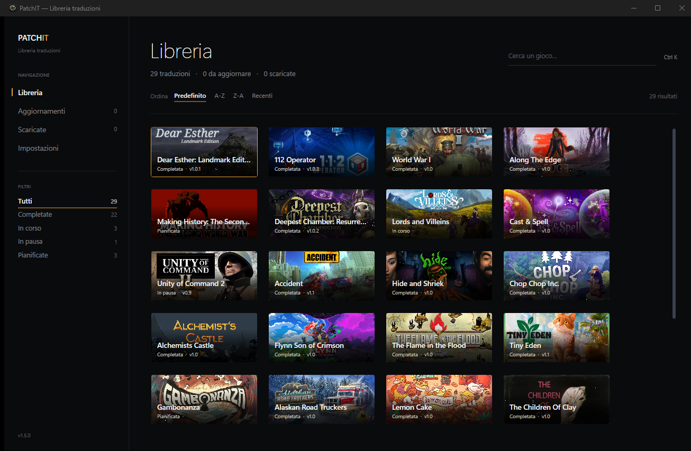

# PatchIT Desktop

App desktop Windows per sfogliare il catalogo delle traduzioni amatoriali di [PatchIT](https://patchit-traduzioni.vercel.app) e scaricarle con un clic.

## Scarica

1. Vai sulla pagina [Releases](https://github.com/matteogit-dev/patchit-desktop/releases)
2. Scarica `PatchIT.exe` dall'ultima release
3. Avviala: **non serve installare niente**

Requisiti: Windows 10/11 a 64 bit. Nessun runtime .NET richiesto (build self-contained).

> Windows può mostrare l'avviso "Windows ha protetto il PC" al primo avvio (l'exe non è firmato digitalmente): clicca **Più informazioni → Esegui comunque**.

## Funzionalità

- **Catalogo completo** con cover, ricerca su titolo, descrizione e categorie, filtri per stato (completate, in corso, in pausa, pianificate) e ordinamento Predefinito, A-Z, Z-A o Recenti
- **Ricerca globale con `Ctrl+K`**: una palette che cerca anche tra le sezioni dell'app, da guidare con `↑` `↓` e `↵`
- **Scarica e installa in un gesto**: la patch viene scaricata, verificata e copiata nella cartella del gioco che indichi, con l'elenco completo dei file mostrato prima della copia
- **Backup e ripristino**: i file sostituiti vengono salvati prima della copia e **Ripristina file originali** li rimette com'erano
- **Download robusto**: barra di progresso per ogni gioco, annullamento, ripresa da dove si era fermato, verifica `sha256` e riprova automatica sugli errori di rete. La cartella di download si sceglie in Impostazioni e può essere diversa per ogni gioco (di default `Downloads\PatchIT`)
- **Aggiorna tutto**: le patch obsolete finiscono in coda e vengono scaricate una dopo l'altra, con un unico avanzamento e il pulsante **Ferma**; le card segnalano `DA AGGIORNARE`, `SCARICATA` o `NEL GIOCO`
- **Verifica integrità** dei file scaricati, singola o in blocco dalle Impostazioni
- **Aggiornamento dell'app**: quando esce una nuova versione, il pulsante nel footer scarica il nuovo `PatchIT.exe`, sostituisce l'eseguibile e riavvia l'app
- **Istruzioni di installazione e changelog** integrati nella scheda di ogni gioco, con la cronologia dei download nelle Impostazioni
- Le patch distribuite su **Steam Workshop** si aprono direttamente nel browser

## Scorciatoie

| Tasto | Azione |
| --- | --- |
| `Ctrl+K` | Apre la palette dei comandi |
| `Ctrl+F` | Porta il cursore nella ricerca (fuori dalla libreria apre la palette) |
| `F5` | Ricarica il catalogo |
| `Invio` / `Spazio` | Apre la scheda del gioco selezionato |
| `Esc` | Chiude scheda, palette o conferma |
| `↑` / `↓` | Con la scheda aperta, passa al gioco precedente o successivo |
| `↵` / `Esc` | In una conferma: esegue o annulla |

## License

Traduzioni e codice: uso personale e non commerciale. Non ridistribuire le patch senza autorizzazione.
